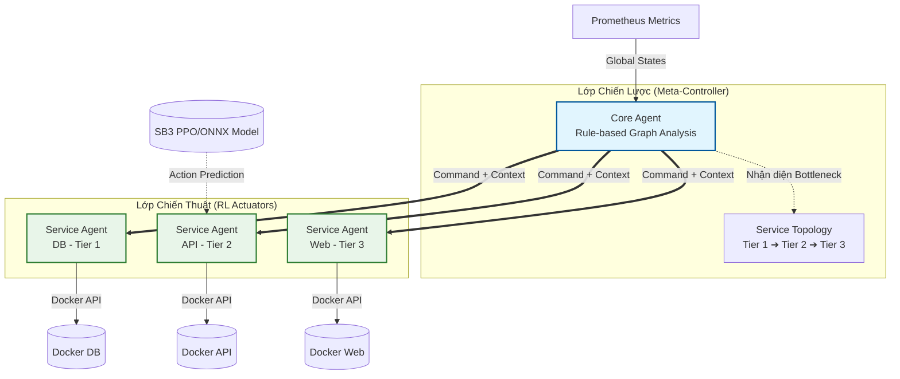

# Service Docker Orchestrator (SDO) v3.0
**Hierarchical Multi-Agent Reinforcement Learning Orchestrator**

SDO v3.0 là hệ thống điều phối container Docker tự động thế hệ mới, kết hợp sức mạnh của học tăng cường (Reinforcement Learning - RL) và hệ thống luật cứng dựa trên Đồ thị phụ thuộc (Dependency Topology Rule-based Guardrails).

## 🌟 Kiến trúc Tổng Quan (Hierarchical Architecture)

Kiến trúc SDO v3.0 được phân tách thành 2 lớp rõ rệt: **Core Agent** (Bộ não chiến lược) và **Service Agents** (Tay sai chiến thuật). Sự kết hợp này giải quyết bài toán cốt lõi của RL truyền thống: Khó kiểm soát toàn cục (Non-stationarity) và Lời nguyền số chiều (Curse of Dimensionality).



## 🧠 Nguyên Lý Hoạt Động (How it works)

### 1. Core Agent (Chỉ huy Giao thông)
Hoạt động thuần túy dựa trên thuật toán if-else và đồ thị (Topology). Trách nhiệm chính:
*   **Circuit Breaker:** Ngắt kết nối Load Balancer khi máy chủ vật lý (Host) có dấu hiệu sập (CPU/MEM > 95%).
*   **Bottleneck Detection:** Quét Topology để tìm ra service gốc rễ gây lỗi. (VD: Nếu DB chậm, API và Web bị lỗi theo → Kết luận DB là thủ phạm).
*   **Guardrails (Luật cứng):** Áp đặt các màng lọc tuyệt đối an toàn.
    *   *Luật 1:* Cấm Service hạ nguồn (Downstream) scale_up khi Service gốc đang nghẽn.
    *   *Luật 2:* Cấm Service hạ nguồn scale_down khi Service gốc đang trong quá trình phục hồi (chờ dữ liệu).

### 2. Service Agents (Tài xế chuyên biệt)
Mỗi service được quản lý bởi một RL Model độc lập.
*   Chỉ quan tâm đến tài nguyên của chính mình (CPU, Mem, Delay, Error, Container Count).
*   Kết hợp dự đoán của RL Model (ví dụ: cần `scale_up` vì CPU tăng nhẹ) với Mệnh lệnh từ Core Agent (ví dụ: `no_op (downstream_blocked)` vì DB đang chết) để đưa ra hành động cuối cùng.
*   **Độc lập sinh tồn:** Nếu Core Agent sập, Service Agent tự động chuyển sang chế độ Standalone Mode, tự query Prometheus và tự sinh tồn theo Model RL.

## 🚀 Tính Năng Nổi Bật (Key Features)

*   **Zero Double-Query:** Metric được query 1 lần duy nhất ở Core Agent và truyền dưới dạng Context cho Service Agent (Tiết kiệm độ trễ từ 9s xuống 5s).
*   **Chống Hiệu ứng Domino (Cascade Failure Prevention):** Giải quyết dứt điểm tình trạng RL hoảng loạn scale/restart vô tội vạ khi một service bị sập dây chuyền.
*   **Min/Max Container Limits:** Các luật an toàn (Guardrails) được ép cứng bất chấp dự đoán của RL Model.
*   **Rollback Tự Động:** Chụp snapshot trước khi Action. Nếu Health tụt quá 10% sau khi thực hiện, tự động rollback và khóa RL tạm thời (Fallback to Rules).

## 💻 Cài đặt & Sử dụng

### Yêu cầu hệ thống
*   Docker & Docker Compose
*   Prometheus, cAdvisor, Node Exporter
*   Python 3.10+ (Stable Baselines 3, ONNX)

### 1. Khởi tạo Topology (sdo.yml)
File cấu hình `sdo.yml` phải định nghĩa rõ ràng `tier` và `depends_on`. Càng nhỏ, Tier càng ưu tiên (Tier 1 thường là DB/Redis).
```yaml
services:
  db:
    tier: 1
    depends_on: []
    min_containers: 1
    max_containers: 3

  api:
    tier: 2
    depends_on: ["db"]
    min_containers: 1
    max_containers: 10

  web-app:
    tier: 3
    depends_on: ["api"]
    min_containers: 1
    max_containers: 8
```

### 2. Chạy Orchestrator
Thiết lập đường dẫn file config và khởi động Core Agent:
```powershell
$env:SDO_CONFIG="C:\path\to\sdo.yml"
python -m orchestrator.main multi-agent
```

*(Các cờ hỗ trợ: `--rules` để ép chỉ chạy Rule-based (tắt RL), `--dry-run` để giả lập hành động mà không gửi lệnh đến Docker).*

### 3. Theo dõi trạng thái (CLI)
```powershell
python -m orchestrator.main status
```

## 📊 Mô tả Hành Động của Agent (Action Space)
Hệ thống sử dụng Action Space gồm 7 hành động (Discrete 7):
*   `0`: **no_op** (Giữ nguyên)
*   `1`: **scale_up** (+1 container)
*   `2`: **scale_down** (-1 container)
*   `3`: **restart_unhealthy** (Khởi động lại các container chết)
*   `4`: **rollback** (Trở về trạng thái trước đó)
*   `5`: **do_nothing_cooldown** (Đang trong thời gian chờ)
*   `6`: **kill_and_replace** (Xóa sạch và tạo lại)

---
*Phát triển bởi đội ngũ SDO - Optimized with Hierarchical RL Architecture.*
